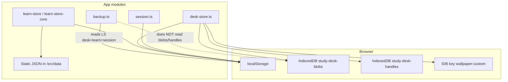

# Study Desk — Data Model Map (Phase 0)

**Date:** 2026-10-28  
**Certainty:** Confirmed from source unless noted.

---

## Storage layers

### localStorage keys (`src/lib/storage-keys.ts`)

| Key | Owner | Contents |
|-----|--------|----------|
| `studydesk.session` | `session.ts` | `{ id, name, email, plan }` — no password |
| `studydesk.desk` | `desk-store.ts` | DeskState **without** large `dataUrl`s |
| `studydesk.learn` | `learn-store*.ts` | LearnState (JP/EN tracks, cards, roadmap, evidence) |
| `studydesk.theme` | desk / i18n helpers | Legacy / theme solid id |
| `studydesk.wallpaper` | desk | Wallpaper preset id |
| `studydesk.tourDone` | help-content | Tour flag |
| i18n lang key | `i18n.tsx` | `vi` \| `en` |

### IndexedDB

| DB / key | Purpose |
|----------|---------|
| `study-desk-blobs` / store `files` | `dataUrl`, `source:{id}`, content/annotation blobs |
| `study-desk-handles` | File System Access handles for Ctrl+S overwrite |
| `wallpaper:custom` | Custom background image bytes |

### Static curriculum (bundled)

| Path pattern | Role |
|--------------|------|
| `src/data/openjlpt-*-seed.json` | JP vocab by band (lazy via `vocab-seeds.ts`) |
| `src/data/cefrj-vocab-seed.json` | EN vocab |
| `src/data/gloss-vi-*.json` | VI overlays (lazy by track) |
| `src/data/grammar-*.json`, `openjlpt-kanji-*.json` | Grammar / kanji banks |
| `src/data/mocks*.json`, `mocks-by-band.json` | Mocks |
| `src/data/placement-*.json` | Placement quizzes |
| `src/data/japan-heritage-seed.json` | Culture |

---

## Desk model (`DeskState` / `DeskFile`)

**File:** `src/lib/desk-store.ts`

| Field | Notes |
|-------|--------|
| `files[]` | `DeskFile`: id, name, kind (`pdf\|note\|audio\|image\|doc`), size, tag, folderId, content, notes, pdfAnnotations, outputs |
| `dataUrl` / `sourceDataUrl` | Runtime + IDB; stripped from LS snapshot |
| `folders[]`, `tasks[]`, `schedule[]` | Overview productivity |
| `focusSeconds`, `studyRoomUrl` | Focus timer; Rooms Meet link |
| `bgMode`, `bgSolid`, `bgGradient`, `wallpaper` | Appearance |

**Outputs:** `DeskOutput` kinds `note | card | clip` — studio side log, not Learn source of truth.

**Connections:**
- DeskStudio → `addManualCard` (`learn-store-core`) writes Learn cards.
- No foreign key from Learn card → Desk file id (manual cards store word/meanings only).

---

## Learn model (`LearnState`)

**Files:** `src/lib/learn-store-core.ts`, `src/lib/learn-store.ts`

| Piece | Shape |
|-------|--------|
| `preferredTrack` | `jp` \| `en` |
| `jp` / `en` `TrackState` | band, placementDone, pathActive, cards[], roadmap, actionProgress, pathGoals, evidence, lessonProgress |
| `SerializedCard` | `sourceId`, track, optional word/meanings, FSRS `card` snapshot, lastGrade |
| Daily counters | reviewsToday, newCardsToday, lookupsToday, dayKey |
| Epoch | `LEARN_PATHS_EPOCH` — wipe paths when bumped |

**Hydration:** `hydrateCard` merges seed + `gloss-vi` for display.

**Scheduler:** `src/lib/fsrs.ts` wraps `ts-fsrs`.

**Evidence:** `src/lib/path-evidence.ts` — credits for review grades, lookups, kanji, grammar, mocks; gates roadmap advancement.

**Roadmap:** `src/lib/roadmap.ts` — weeks/days, `vocabSourceIds`, lesson ids (`ROADMAP_PLAN_VERSION`).

**Lessons:** `src/lib/lessons.ts` — registry linking vocab/grammar/kanji/listening/mock.

---

## Session & backup

| Flow | Behavior |
|------|----------|
| Sign-in | Any email + password length → new UUID session in LS (`auth/page.tsx`) |
| Backup v1 | JSON: session + desk metadata + learn + theme (`backup.ts`) |
| Restore | `saveDesk` + `saveLearn` + session/theme — **does not** restore IDB blobs/handles |
| Side effect | `buildBackup()` calls `loadLearn()` which may seed paths if empty |

---

## Culture / Rooms

| Area | Model |
|------|--------|
| Culture | Static `japan-heritage-seed.json` + client filters; no Learn FKs |
| Rooms | `desk.studyRoomUrl` string; LiveKit env check only |

---

## Gaps vs upgrade pack data goals

| Desired | Current |
|---------|---------|
| Note ↔ document stable anchor | `notes` string on file; PDF anns separate; no char-offset anchors for TipTap |
| Flashcard ↔ source document | Manual card has no `fileId` / selection range |
| Quiz from document | Not implemented |
| Error notebook | Not a first-class entity |
| Provenance / license on imports | Gloss scripts local; no DATA_SOURCE_LICENSE_MATRIX yet |

---

## Compatibility notes

- Desk `DESK_VERSION` migrations in `desk-store.ts`.
- Learn path wipe via `LEARN_PATHS_EPOCH` — intentional destructive migrate.
- Freemium caps exist but `FREEMIUM_ENABLED = false` (`freemium.ts`).
